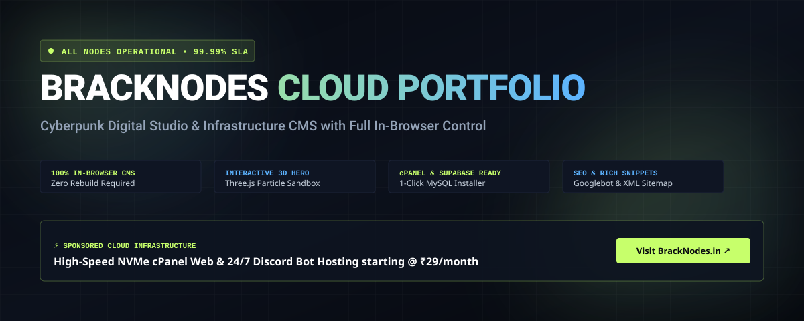

<div align="center">

# ⚡ BrackNodes Cloud &amp; Developer Portfolio CMS

<p align="center">
  
</p>

<p align="center">
  <a href="https://bracknodes.github.io/BrackNodes-Portfolio-Web-01/">
    
  </a>
  <a href="https://bracknodes.in">
    
  </a>
  <a href="https://discord.gg/bracknodes">
    
  </a>
</p>

[](https://react.dev/)
[](https://www.typescriptlang.org/)
[](https://vitejs.dev/)
[](https://threejs.org/)
[](https://bracknodes.in)
[](https://supabase.com)
[](LICENSE)

### **A cutting-edge cyberpunk digital studio &amp; infrastructure portfolio with a 100% in-browser CMS admin panel.**
*Zero rebuilds. Zero vendor lock-in. Engineered for hosting providers, developers, agencies, and indie creators.*

---

### 🔗 Quick Live Access:
| Resource | Direct Link |
| :--- | :--- |
| 🌐 **Live Website (GitHub Pages)** | **[https://bracknodes.github.io/BrackNodes-Portfolio-Web-01/](https://bracknodes.github.io/BrackNodes-Portfolio-Web-01/)** |
| 🎛️ **Admin Control Panel Demo** | **[https://bracknodes.github.io/BrackNodes-Portfolio-Web-01/admin](https://bracknodes.github.io/BrackNodes-Portfolio-Web-01/admin)** |
| ⚡ **Official Cloud Hosting** | **[https://bracknodes.in](https://bracknodes.in)** |
| 💬 **Community Discord Server** | **[https://discord.gg/bracknodes](https://discord.gg/bracknodes)** |

---

</div>

## 📑 Table of Contents

- [✨ Project Overview](#-project-overview)
- [🎛️ Everything is 100% Editable (In-Browser CMS)](#️-everything-is-100-editable-in-browser-cms)
- [⚡ Sponsored by BrackNodes Cloud Hosting](#-sponsored-by-bracknodes-cloud-hosting)
- [🏗️ Architectural Highlights](#️-architectural-highlights)
- [🚀 Quick Start (Under 60 Seconds)](#-quick-start-under-60-seconds)
- [💾 Database Setup (cPanel MySQL or Supabase)](#-database-setup-cpanel-mysql-or-supabase)
- [📦 Production Deployment](#-production-deployment)
- [🤝 Support, Discord &amp; Community](#-support-discord--community)
- [📄 License](#-license)

---

## ✨ Project Overview

**BrackNodes Portfolio CMS** is a production-grade, ultra-performant web application designed for modern web professionals and cloud infrastructure providers. It combines stunning high-tech cyberpunk aesthetics, real-time 3D WebGL physics, and a modular headless CMS that gives administrators complete power over text, layout, 3D scenes, design themes, leads, and SEO directly inside their web browser.

### 🌟 Key Highlights:
- **🎨 Cyberpunk Dark &amp; Light Theming:** Fully synced theme tokens with zero reload lag.
- **🧊 Interactive Three.js 3D Hero:** Dynamic wireframe geometry with customizable rotation, particle fields, and responsive mouse camera tracking.
- **🖥️ Native cPanel MySQL Bridge:** Built-in PHP API (`/public/api/`) with 1-click database table installer for any shared cPanel or VPS hosting.
- **☁️ Supabase Cloud Synchronization:** Automatic cloud persistence with PostgreSQL and Row-Level Security.
- **🔍 Advanced SEO &amp; Schema Suite:** Search engine crawler policy manager, XML sitemap auto-generation, and Schema.org rich snippets (FAQPage &amp; Product JSON-LD).
- **🔒 Enterprise RBAC &amp; Security:** Multi-collaborator role management, rate-limiting, and locked attribution safety.

---

## 🎛️ Everything is 100% Editable (In-Browser CMS)

You never need to touch raw HTML or rebuild the codebase to customize this portfolio. The built-in Admin Control Panel (`/admin`) allows you to modify every single element in real time:

| Section / Tab | What You Can Edit Directly |
| :--- | :--- |
| **Hero &amp; Branding** | Brand wordmark, logo uploads (light/dark/icon), roles, live operational status pill, and primary/secondary CTA buttons. |
| **3D Object Sandbox** | Switch geometry (Icosahedron, Torus Knot, Sphere, Dodecahedron, Cylinder), wireframe color, particle counts, and rotation speeds. |
| **Projects Manager** | Add/edit portfolio projects, tech stack tags, live preview URL, GitHub repository link, and featured flags. |
| **Services &amp; Scope** | Freelance service cards, pricing intervals, scope deliverables, and icons. |
| **Skills &amp; Tech Stack** | Skill badges, proficiency bars, categories, and interactive terminal code preview. |
| **Sprint Process** | 5-stage sprint cards, workflow milestones, timeline estimates, and phase deliverables. |
| **Testimonials** | Client quotes, reviewer names, roles, company logos, and 5-star ratings. |
| **Inquire Form Editor** | Form labels, placeholders, budget ranges, and project focus pill options. |
| **Design &amp; Themes** | 4 prebuilt cyberpunk presets (Cyber Dark, High-Voltage Lime, Obsidian Purple, Light Clean) with live CSS custom token overrides. |
| **Typography** | Global display and monospace font selection, letter tracking, weights, and line heights. |
| **Custom Code (CSS/JS)** | Live injection of Head CSS, Google Tag Manager, Meta Pixel, and Chat widgets without editing files. |
| **SEO &amp; Crawlers** | Meta title, description, canonical domain, robots.txt crawler rules, XML sitemap URLs, and Schema.org rich snippets. |
| **cPanel Database** | Connect to your cPanel MySQL database credentials and run the 1-click table creation installer. |
| **Knowledge Base** | In-app step-by-step developer tutorials, deployment guides, and database schema documentation. |
| **Support &amp; Feedback** | Direct Discord server access and BrackNodes priority ticket portal. |

---

## ⚡ Sponsored by BrackNodes Cloud Hosting

<div align="center">

### **Looking for blazing-fast, affordable hosting for your bots and web applications?**

[](https://bracknodes.in)

</div>

**[BrackNodes.in](https://bracknodes.in)** delivers high-speed, enterprise-grade cloud compute and web hosting engineered specifically for developers, communities, and growing businesses:

- ⚡ **Pure NVMe cPanel Web Hosting (From ₹29/month):**
  - 100% Enterprise NVMe SSD storage with 10x faster load speeds.
  - Free Unlimited AutoSSL certificates, automated daily backups, and unlimited subdomains.
  - 1-Click Softaculous app installer (WordPress, Laravel, Node.js, Python, PHP).
- 🤖 **24/7 Discord Bot Hosting (From ₹29/month):**
  - High-performance Pterodactyl control panels with zero sleep cycles.
  - Native support for Node.js, Python, Java, Rust, and Go.
  - Sub-15ms Asia-South latency routing with instant automated provisioning.
- 🛡️ **Enterprise Anti-DDoS Shield &amp; 99.99% Uptime SLA:**
  - Automated Layer 3/4/7 volumetric attack scrubbing with 1Gbps network uplinks.
  - Asia-South Tier-3 Datacenter facilities with round-the-clock human technical support.

👉 **[Deploy Your Server on BrackNodes.in Today →](https://bracknodes.in)**

---

## 🏗️ Architectural Highlights

```
bracknodes-portfolio-web/
├── docs/                      # Visual documentation & SVG banners
├── public/                    # Static assets & public web engine
│   ├── api/                   # Native cPanel PHP MySQL Bridge
│   │   ├── config.php         # Database configuration credentials
│   │   ├── setup.php          # 1-Click MySQL table installer
│   │   ├── test.php           # Database connection diagnostics
│   │   └── inquiry.php        # Lead submission endpoint
│   ├── favicon.svg            # Cyberpunk vector icon
│   ├── robots.txt             # Search crawler directives
│   └── sitemap.xml            # Priority Google indexing sitemap
├── src/
│   ├── components/            # UI components (Navbar, Footer, ContactForm, Cards)
│   │   └── admin/             # Admin protection & BrackNodes promotional cards
│   ├── context/               # CMSContext & AuthContext state management
│   ├── data/                  # Default portfolio and configuration fallbacks
│   ├── pages/admin/           # Full-featured in-browser CMS suite (18+ views)
│   │   ├── views/             # Individual sub-views (Hero3D, Projects, SEO, Design...)
│   │   └── AdminLayout.tsx    # Cyberpunk admin navigation shell
│   ├── sections/              # Homepage sections (Hero, About, Projects, Services...)
│   ├── styles/                # Design tokens & responsive CSS architecture
│   └── types/                 # Strict TypeScript schemas for all CMS entities
└── index.html                 # App shell with Schema.org JSON-LD rich snippets
```

---

## 🚀 Quick Start (Under 60 Seconds)

### Prerequisites
- **Node.js:** v18.0.0 or higher
- **Package Manager:** npm, pnpm, or yarn

### 1. Clone the Repository
```bash
git clone https://github.com/bracknodes/BrackNodes-Portfolio-Web-01.git
cd BrackNodes-Portfolio-Web-01
```

### 2. Install Dependencies
```bash
npm install
```

### 3. Launch Development Server
```bash
npm run dev
```
Open [http://localhost:5173](http://localhost:5173) in your browser.

### 4. Access Admin Control Panel
Navigate to [http://localhost:5173/admin](http://localhost:5173/admin) to explore and test the CMS suite!

---

## 💾 Database Setup (cPanel MySQL or Supabase)

This project gives you total freedom to choose how your content is stored:

### Option A: Local Storage (Default &amp; Offline Ready)
By default, the CMS runs instantly using persistent browser storage with automatic state recovery. No setup required!

### Option B: Native cPanel MySQL Bridge (Zero External Dependencies)
1. Open cPanel on your [BrackNodes](https://bracknodes.in) or any web hosting account.
2. Create a MySQL database and database user via **MySQL Databases**.
3. Edit `public/api/config.php` with your database credentials:
   ```php
   define('DB_HOST', 'localhost');
   define('DB_NAME', 'your_cpanel_dbname');
   define('DB_USER', 'your_cpanel_dbuser');
   define('DB_PASS', 'your_secret_password');
   ```
4. Visit `https://yourdomain.com/api/setup.php` in your browser. The tables (`site_settings`, `projects`, `services`, `inquiries`, `collaborators`) will be auto-generated in 1 second!
5. In Admin Panel, open **Account &amp; Database** to verify connection diagnostics.

### Option C: Supabase Cloud (PostgreSQL)
1. Create a free project at [supabase.com](https://supabase.com).
2. Copy your Project URL and Anon API Key into `.env`:
   ```env
   VITE_SUPABASE_URL=https://your-project.supabase.co
   VITE_SUPABASE_ANON_KEY=your-anon-key
   ```
3. Run the schema script provided inside Admin Panel → **Knowledge Base → Database &amp; Supabase Guide** in your Supabase SQL Editor.

---

## 📦 Production Deployment

### Build for Production
```bash
npm run build
```
This generates an optimized, minified bundle in the `dist/` directory.

### Deploying to cPanel (Apache / LiteSpeed)
1. Upload all contents of the `dist/` folder into your cPanel `public_html/` directory (or subdomain root).
2. Upload the `public/api/` folder into `public_html/api/`.
3. Add a standard `.htaccess` file in `public_html/` to support client-side routing:
   ```apache
   <IfModule mod_rewrite.c>
     RewriteEngine On
     RewriteBase /
     RewriteRule ^index\.html$ - [L]
     RewriteCond %{REQUEST_FILENAME} !-f
     RewriteCond %{REQUEST_FILENAME} !-d
     RewriteRule . /index.html [L]
   </IfModule>
   ```

### Deploying to Vercel or Netlify
- **Build Command:** `npm run build`
- **Output Directory:** `dist`
- **Install Command:** `npm install`

---

## 🤝 Support, Discord &amp; Community

Need assistance, want to suggest new features, or have questions about server deployments?

- 💬 **Discord Server:** [Join Official BrackNodes Discord](https://discord.gg/bracknodes)
- 🌐 **Website &amp; Ticket Portal:** [https://bracknodes.in](https://bracknodes.in)
- 📧 **Direct Email:** [support@bracknodes.in](mailto:support@bracknodes.in)
- 🐛 **Report a Bug:** [Open GitHub Issue](https://github.com/bracknodes/BrackNodes-Portfolio-Web-01/issues)

---

## 📄 License

This project is licensed under the **MIT License** — see the [LICENSE](LICENSE) file for complete details.

<div align="center">

**Designed &amp; Engineered by [BrackNodes Cloud](https://bracknodes.in)**  
*High-Speed NVMe Web &amp; Discord Bot Hosting Starting at ₹29/Month*

</div>
